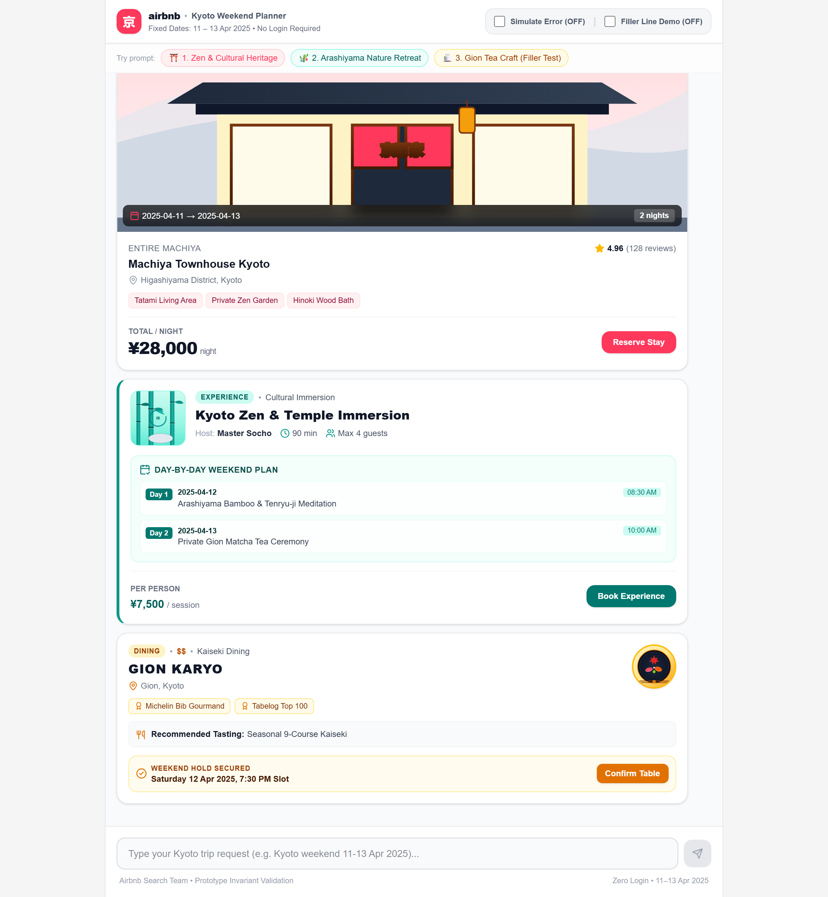

# Airbnb Kyoto Weekend Trip Planner ⛩️

A conversational trip planner prototype built for the **Airbnb Search Team** to replace complex filter panels with an intuitive chat interface. Deployed for user testing with 8 guests for a fixed Kyoto weekend (**April 11–13, 2025**).



---

## 🚀 Running the App

```bash
npm install && npm run dev
```
Open [http://localhost:3000](http://localhost:3000) in your browser.

---

## ✨ Key Features & UX Invariants

1. **Zero Login Access (Frictionless UX):**
   - Accessible immediately on mobile and desktop private windows with no authentication barrier.

2. **Input Lock & 2-Second Thinking Animation:**
   - On submission, the text input and send button lock (`disabled`) while a 3-dot pulsing animation signals itinerary synthesis for ~2 seconds.

3. **Three Visually Distinct Card Components (Fixed Order):**
   - **`StayCard.tsx` (Lodging):** Full-width 16:9 hero image, largest text is nightly price (e.g. `¥28,000 / night`), Airbnb Coral (`#FF385C`) accent, Superhost badge, and fixed dates overlay (`11 – 13 Apr 2025`).
   - **`ExperienceCard.tsx` (Immersion):** Left-aligned square thumbnail (`w-20 h-20`), largest text is the experience title, Bamboo Forest Teal (`#008489`) 4px accent border, and a structured Day-by-Day Weekend Plan (Day 1: Sat 12 Apr, Day 2: Sun 13 Apr).
   - **`FoodCard.tsx` (Dining):** Right-aligned circular avatar (`w-16 h-16`), largest text is the uppercase restaurant name, Warm Ochre (`#D97706`) accent, Michelin Bib Gourmand badge (`$$`), and confirmed Saturday 7:30 PM reservation hold.

4. **Graceful Empty Field Filler Lines:**
   - Empty or missing fields cleanly display a short filler line (`—`) rather than `undefined`, `null`, or awkward blanks.

5. **Deterministic Error Recovery ("The Bad Moment"):**
   - Controlled via the `#toggle-simulated-error` switch in the navigation bar.
   - When active, simulates a network failure with an empathetic, friendly error bubble and an inline **"Try again"** button.
   - Clicking **"Try again"** automatically resets the switch to **OFF** and re-fetches all three cards cleanly with zero blank-screen moments.

---

## 🛠️ Tech Stack

- **Framework:** Next.js 16 (App Router)
- **Styling:** Tailwind CSS
- **Icons:** Lucide React
- **Testing:** Playwright Automation Test Suite
